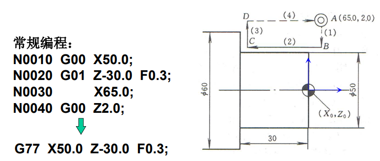
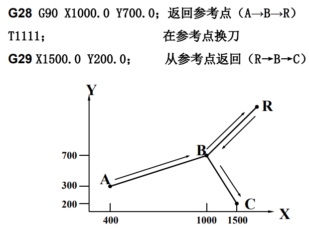
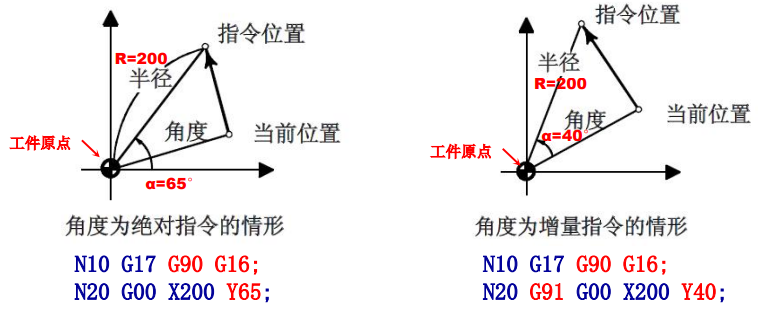
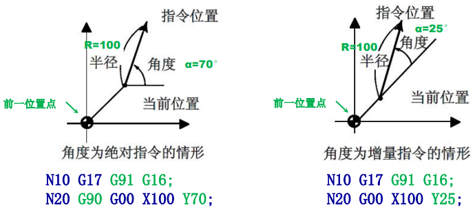
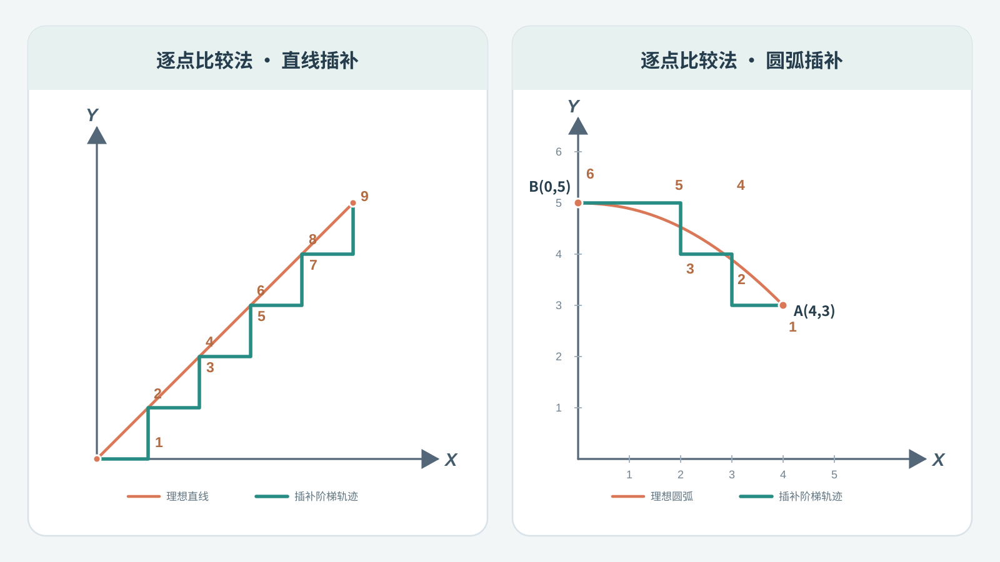
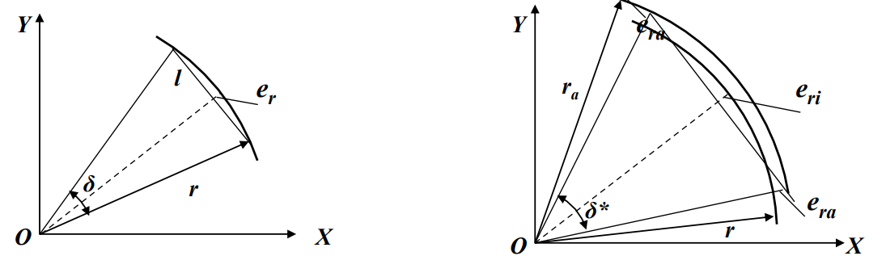
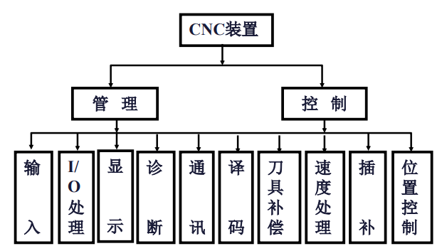
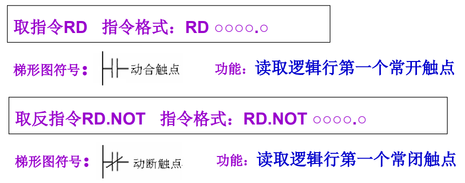
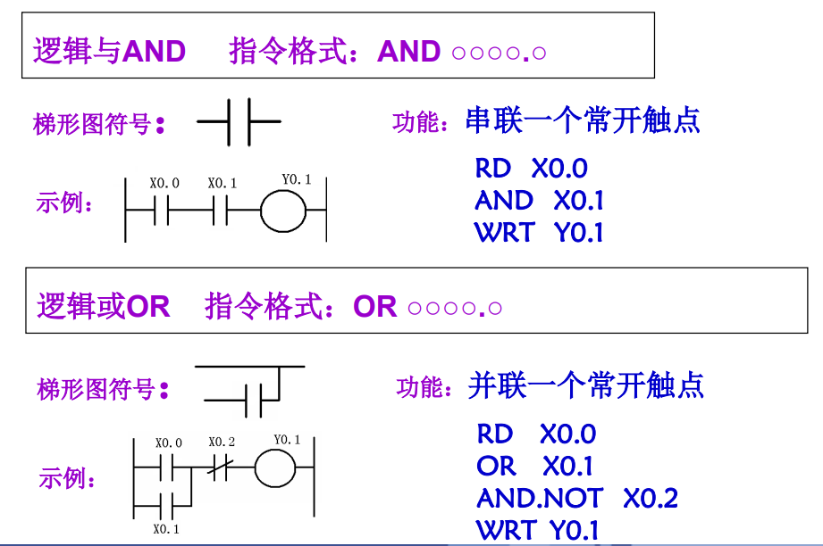

# 数控技术补天提纲
## 第一章  概论
### 基本概念
- 数字控制(NC, Numerical Control)
- 数控机床(NCMT, Numerical Controlled Machine Tool)
- 数控系统(NCS, Numerical Controlled System)
- 计算机数控 (CNC, Computer Numerical Control)
- 计算机辅助设计(CAD, Computer Aided Design)
- 计算机辅助制造(CAM, Computer Aided Manufacturing)
- 计算机辅助工程 (CAE, Computer Aided Engineering)
中文与英文缩写能对应即可
### 数控机床的组成

复习课上写的是数控装置、伺服驱动装置和检测反馈装置、机床本体三部分，对应上面三部分。
### 数控机床的特点
1. **小批量**而又轮番生产的零件；（2025）
2. **几何形状复杂**的零件：
3. 在加工过程中必须进行**多种工序**加工的零件；
4. **切削余量大**的零件；
5. 必须**严格控制公差**（公差带范围很小）的零件；
6. **工艺设计会经常变化**的零件；
7. **贵重**零件：
8. 需全部检测的零件，等等。
### 数控机床的分类
#### 按控制系统分类

| 控制方式 | 说明 |
| --- | --- |
| 点位控制 | 只能控制刀具从一个位置精确地移动到另一个位置，而不管中间的移动轨迹如何。 |
| 直线控制 | 不仅要控制两相关点之间的位置，还要控制刀具沿某一坐标方向移动的速度和轨迹。 |
| 轮廓控制 | 同时对两个或两个以上的坐标轴进行连续控制，需要保证加工过程中每个点的速度和位置。 |
#### 按伺服系统分类

| 伺服系统类型 | 工作方式与特点 |
| --- | --- |
| 开环伺服 | 输出信号给伺服系统驱动机床运动，没有来自传感器的反馈信号。较为经济，但速度、精度低。 |
| 闭环伺服 | 接受插补器指令及工作台端反馈信号进行比较修正，有效消除传动部件引起的误差；系统复杂，成本高。 |
| 半闭环伺服 | 测量元件从工作台移到电机端头或者丝杆端头。可以获得稳定的控制特性，且容易调整。 |

#### 按工艺方法分类

| 类别 | 数控机床举例 |
| --- | --- |
| 金属切削类 | 数控车床、数控铣床、数控磨床、数控镗床、加工中心 |
| 金属成形类 | 数控回转头压力机、数控折弯机、数控组合冲床、数控弯管机 |
| 数控特种加工 | 数控线（电极）切割机床、数控电火花加工机床、数控火焰切割机、数控激光切割机床 |
#### 按功能水平分类
高档/中档/低档数控机床，可能按照精度或轴数划分
#### 按驱动方式分类
步进式/直流伺服/交流伺服/非电驱动
## 第二章 数控编程
### 基本概念
根据被加工零件的图纸及其技术要求，工艺要求等切削加工的必要信息，按数控系统所规定的指令和格式编制数控加工指令序列，分为手动编程、自动编程。

### 数控编程内容与步骤

### 数控机床中的坐标
#### 坐标轴
机床的坐标轴包含互相垂直的**X、Y、Z直线运动轴**和绕其旋转的**A、B、C旋转运动轴**。
直线运动轴相互位置关系由**右手直角笛卡尔坐标系**确定，即右手拇指指向 X 轴正向、食指指向 Y 轴正向，那么与二者垂直的中指就指向 Z 轴正向。因此，确定其中两个轴的正向后，第三个轴的正向也就确定了。
旋转运动轴则用**右手螺旋定则**规定正向：右手拇指指向对应直线轴的正方向，其余四指弯曲的方向就是旋转正方向。（2024）
某部件运动的**正方向**，是**增大工件和刀具之间距离的方向**
#### z轴确定

- **传递主要切削力的主轴为 Z 轴（铣、车）**。（2024）
 - **若没有主轴，则 Z 轴垂直于工件装夹面（刨）**。
#### 工件坐标系与机床坐标系
数控加工中使用的坐标系有两种：
1. 机床坐标系：是机床固有坐标系，**由厂家设定坐标原点（零点）**，不能直接用于编程。
2. 工件坐标系：编程人员以工件图纸上的合适位置建立的坐标系，**编程尺寸都按工件坐标系来确定**。

为了统一两种坐标系，通过**对刀**来确定**程序原点**在**机床坐标系**中的位置，建立**工件坐标系**。（2024）
以车外圆为例，对刀可以这么理解：
1. 让刀尖接触或轻车工件右端面，把这个位置作为 Z 零点。
2. 试车一小段外圆，测量实际直径。例如测得直径 60 mm，就把此时刀尖的 X 坐标设为 60。
##### 工件零点的选取原则
1. 工件零点应选在**零件的尺寸基准**上，这样便于坐标值的计算，并减少错误；
2. 工件零点尽量选在**精度较高的工件表面**，以提高被加工零件的加工精度
3. 对于**对称**零件，工件零点设在**对称中心**上；
4. 对**一般零件**，工件零点设在工件轮廓**某一角**上；
5. **Z轴方向上**零点一般设在**工件表面**。
##### 机床参考点
机床参考点是用于对机床运动进行检测和控制的固定点。其位置是由机床制造厂家在每个进给轴上用限位开关精确调整好的，坐标值已输入数控系统中。因此**参考点对机床原点的坐标是一个已知数**。编程时该点一般作为**程序起点**和**换刀点**。
- 通常在**数控铣床**上机床**原点**和机床**参考点**是**重合**的
- 在**数控车床**上机床参考点是**离机床原点最远的极限点**。
### 数控程序的结构与形式
#### 标准
有ISO（国际标准化协会）和EIA（美国电子工业协会）两种标准，不同厂商、产品有一定自主性。
#### 模态代码和非模态代码
模态代码：同组其它代码出现前一直有效。
非模态代码：只在指令它的程序段中有效。
#### 结构

#### 程序序号
程序的记录是由程序号来辩别的，调用某个程序可通过程序号来调出，编辑程序也要首先调出程序号。程序号由字母“O”接4位数（1～9999）表示（如上图O2001、O1001）
#### 程序段结构
程序段主要是由程序段序号和各种功能指令构成的：  
N__ G__ X（U）__ Z（W）__ F__ M__ S__ T__
例如`N10 G01 X80.0 Z100.0 F0.2 M03 S600 T0101`
其中N10为**程序段号**，可以理解为**代码的行号**，考试时以10为单位递增即可（如上图程序）。其余的部分接下来会详细说明。
#### 坐标表示
**绝对坐标**在程序中表示为**X、Y、Z**，**相对坐标**则为**U、V、W**。X、Y、Z与U、V、W在一个程序段内**可以混用**；**车床**数控系统中，X方向坐标值使用**直径值**。
#### F功能
即上面的F__。代表进给速度。两种计算单位：**每分钟进给(mm\min)，每转进给 (mm\r)**。
#### S功能
即上面的S__。代表主轴功能。指令格式：S xxxx
主轴功能也称**主轴转速**功能，它是定义主轴转速的功能。主轴功能由S及后面的数字组成，**单位为r／min**。
#### T功能
即上面的T__。代表刀具功能。指令格式：T xx （xx表示刀具号）　　
T功能是用来进行选择刀具的功能，它是把指定了刀号的刀具转换到换刀位置，为下次**换刀**做好准备。**xx是为下次换刀使用的刀具**，本次所用刀具应在前面程序段中写出。车削中T xx xx **后两位表示刀补号**，Txx**00为取消刀补**
刀补后面会讲
### G代码
G代码代表准备功能，即定义运动方式。（G代码没有的功能，2025）
#### G00
快速点定位指令：使刀具以**点位控制**方式从其所在点以最快速度移动到坐标系的另一点。编程格式：`G00 X_Y_Z_` ( X_Y_Z_为目标点坐标)
#### G01
**直线**插补：控制各轴以指定的进给速率**沿直线方向**从当前位置移动到指令位置，**模态代码**。
格式：`G01 Xx Yy Zz Ff`
令$L=\sqrt{x^2+y^2+z^2}$，那么此时x轴方向的进给速度$F_x=\dfrac{x}{L}f$。
例如直线轴插补：`G91 G01 X200.0 Y100.0 F200.0`
旋转轴插补： `G91 G01 C –90.0 F300.0`
此处**G91**表示**采用增量坐标编程**：指令中的坐标值表示相**对于当前位置的位移量**。C这个不要求掌握。

模态代码的意思就是
```
N060 G01 X32.0 Z0.0 S1000 F0.15；
N070 G01 X36.0 Z-2.；
N080 G01 X36.0 Z-40.0；
N090 G01 X60.0 Z-40.0；
N100 G01 X60.0 Z-65.0；
```
可以写成
```
N060 G01 X32.0 Z0.0 S1000 F0.15；
N070 X36.0 Z-2.；
N080 X36.0 Z-40.0；
N090 X60.0 Z-40.0；
N100 X60.0 Z-65.0；
```
写一次后会持续有效，后续程序段可以省略，直到被 G00、G02、G03 等同组指令替换。
#### G02/G03
顺时针/逆时针**圆弧**插补。
**顺、逆方向判断**：沿垂直于圆弧所在平面，从**正向往负向看**，**刀具相对工件**转动方向是顺时针用G02，反之用G03。

上面的编程格式中
- X_Y_Z_：圆弧**终点坐标**；
- I_J_K_：**圆心**编程，是**圆弧起点到圆心的X、Y、Z方向增量**，**矢量指向圆心**；
- R_：**半径**编程。

| 程序指令 | 圆弧轨迹 |
| --- | --- |
| `G02 X321.65 Y280 I40 J140 F200`<br>或<br>`G02 X321.65 Y280 R-145.6 F200` |  |

**圆弧大于180度时**用**R为负值**来表示（2025）；**整圆时必须用IJK表示**。
#### G41/G42/G40
刀具半径补偿指令：在计算刀具中心轨迹时，把刀具半径考虑进去，从而使刀具切出的边界与零件轮廓一致。
沿加工前进方向，当**刀具中心轨迹在编程轨迹(零件轮廓)左边**时，称为**左刀补**，用G41指令实现；反之为**右刀补**，用G42实现。
**G41/G42:左/右刀具补偿；G40：刀具补偿取消。**

（只要移动就可以进行刀补x，2025）
#### G70/G71
G71：外径粗车循环：适用于圆柱毛坯料粗车外径和圆棒毛坯料粗车内径。
G70：精车循环：当用G71粗车工件后，用G70来指定精车循环，切除粗加工中留下的余量。
代码格式
```
N … G71 U(Δd) R (e) ;
N … G71 P(ns) Q(nf) U(Δu) W(Δw) F(f) S (s) T(t) ;
N ns 理论轮廓开始
N … 此部分中的 F/S/T 只对G70生效
N …
N nf 理论轮廓结束
N … G70 P(ns) Q(nf)
```
其中：
- Δd：切削深度（半径给定 ）
- e： 退刀量
- ns： 精加工程序第一个程序段的顺序号。
- nf： 精加工程序最后一个程序的顺序号。
- Δu：X方向精加工余量。（直径值）
- Δw：Z方向精加工余量。
- F,S,T：包含在ns到nf程序段中的任何F、S、T功能在循环中被忽略，而在G71程序段落中F，S或T功能有效。
#### G90/G91
G90是绝对值编程指令，G91是增量值编程指令

| 程序指令 | 编程示例 |
| --- | --- |
| `G90 X40.0 Y70.0`：绝对值编程<br><br>`G91 X-60.0 Y40.0`：增量值编程 |  |

### M代码
M代码代表辅助功能，即机床的辅助动作。

| 指令 | 功能与说明 |
| --- | --- |
| M02 | 程序**结束**。编在最后一个程序段中，执行完程序内所有指令后，主轴停止、进给停止、切削液关闭。 |
| M03 | 主轴**正转**。按 JB/T 3208—1999，正转是右旋螺纹进入工件的旋向。（2024） |
| M04 | 主轴**反转**。按 JB/T 3208—1999，反转是右旋螺纹离开工件的旋向。（2024） |
| M05 | 主轴停转。 |
| M08 | 冷却液开。 |
| M09 | 冷却液关。 |
| M30 | 程序**结束**。除具有 M02 的功能外，还**返回到程序头，准备下一个工件的加工**。 |

#### G54/G92
G54～G59：选择工件坐标系指令

G92：工件坐标系设定指令

| 程序指令 | 坐标系示例 |
| --- | --- |
| `G92 X400. Z250.`<br><br>指定当前点为该坐标值。 |  |

#### M98/M99
子程序调用。格式为`M98 Pxxxx Lxxx`
其中P后面的四位为子程序号，L后面的三位为重复调用次数，最多调用999次

但是这里给出的图格式又为`M98 Pxyyyy`，这里的x是重复调用次数，yyyy是子程序号。总之具体格式取决于数控系统。
M99表示子程序结束，并返回调用它的主程序，继续执行 M98 后面的指令。
### 用户宏程序
实际上宏程序是一种功能。课件上的表述似乎认为其是一种特殊的子程序，但是其实主程序也可以是宏程序。在宏程序主体中，除了使用通常的CNC指令外，还可以**使用变量**的CNC指令，进行变量运算，宏指令可以给变量设定实际值。
意思就是，一般的数控指令只能使用常量，但是宏程序可以使用变量，类似高级编程语言中的变量赋值与运算。
变量用＃和后面的数字表示，其格式为：`＃i`（i =1,2,3…）
变量可以代替宏程序中地址后面的数值。 例：`F＃103`，`G00 Z-＃100`， `G＃130`.
变量代表的真值不能带小数点，因此**尺寸、角度单位用0.001mm（°）** 为单位。例如#100=10，则 X #100 表示 X 0.01 (0.01mm)。
### 高速深孔钻削循环（G73）
高速深孔钻削循环（G73）格式为`G73 X_Y_Z_R_Q_F_K_；`
X_、Y_：为孔位置数据
Z ：增量编程时指从R点到孔底的增量 绝对编程时指孔底的坐标值
R ：增量编程时指从初始平面到R点的增量 绝对编程时指R点的坐标值
Q_：每次切削进给的深度
K ：加工相同距离的多个孔时， 指定循环次数K （孔位坐标增量有效）。如果程序中选择了G90（绝对值）方式，刀具在原来孔的位置重复加工，如果选择G91（增量）则用一个程序段就能实现分布在一条直线上的若干个等距孔的加工。K这个指令仅在被指定的程序段中才有效。
记忆：跟孔底有关是Z（最后一个字母），其余跟R点有关是R
R 平面就是钻孔时，刀具从“快速靠近”（快进）切换为“按进给速度钻入”（工进）的高度平面。一般设在工件表面上方，留一点间隙。
### 单一形状车削循环
####  外圆车削循环
指令格式`G77 X（U） Z(W) F ；`其中，X、Z为车削进给路径的终点坐标，（U，W）为终点C相对于起点A坐标值的增量。 

#### 锥面车削循环
指令格式：`G77 X（U） Z(W) I（R） F`
X、Z为车削进给路径终点坐标，I为圆锥切削时的半径差,R为锥度，用增量值表示，正负符号取决于锥端面位置。
###  参考点返回指令
- 参考点是CNC机床上的固定点，可以利用参考点返回指令将刀架移动到该点。
- 可以设置最多四个参考点，其中第一参考点与车床参考点一致，第二、第三和第四参考点与第一参点的距离利用参数事先设置。
- 必须先进行第一参考点返回，否则不能进行其他操作。
#### 自动参考点返回
```
G28 X(U)_ Z(W);      /* 第一参考点返回
G30 P2 X(U)_ Z(W);   /* 第二参考点返回
G30 P3 X(U)_ Z(W);   /* 第三参考点返回
G30 P4 X(U)_ Z(W);   /* 第四参考点返回
```
其中X(U)、Z(W)为参考点返回时经过的中间点，X、Z为绝对坐标，U、W为相对坐标。
#### 从参考点返回指令
格式：`G29 X_ Z_`
使刀具从参考点经中间点（G28指令指定）到达目标点，X、Z后面的数值为刀具的目标点坐标，使用G29指令前必用G28指令。

### 极坐标功能指令
G16为极坐标系生效指令，G15为极坐标系取消指令
极坐标尺寸指令用于把编程终点位置用极坐标的形式来表示，即以极坐标半径和极坐标角度来确定点的位置。
极坐标的零度方向为第一坐标轴的正方向，**逆时针方向为角度方向的正向**。
#### 绝对式
当半径指定为绝对式：`G90 G16`
1. 工件坐标系的**原点**成为极坐标的中心。
2. 以绝对值指定半径值。
3. 该方式下，角度值仍可指定为绝对式或增量式。

#### 增量式
当半径指定为增量式：G91 G16
1. 所处的**当前位置**成为极坐标的中心。
2. 以增量值指定半径值。
3. 该方式下，角度值仍可指定为绝对式或增量式。

## 第三章 插补原理
### 概述
#### 定义
插补是用被加工轨迹的有限信息(如起点和终点之间),计算插进刀具运动的许多中间点,进行数据点的密化工作,然后用已知线型(如直线、圆弧等)逼近。
#### 插补的两层意义（2024）
即基本线型的形成及如何分段逼近。
- **基本线型**:由插补指令完成。如直线插补、圆弧插补、抛物线插补、螺旋线插补、极坐标插补等,插补指令越多,越能实现复杂型面的加工。
- **分段逼近**:按允许误差,弦线、割线、切线逼近。
### 基准脉冲插补
基准脉冲插补可以理解为数控系统拿一个个固定大小的脉冲作为基本单位，决定刀具每一步往哪个方向移动。
#### 逐点比较法

举个最简单的例子。假设 X 轴每收到一个脉冲，移动 0.01 mm。Y 轴每收到一个脉冲，也移动 0.01 mm。现在要让刀具从原点沿直线运动到终点。系统不是一次性告诉电机走完整条直线，而是：
1. 发出一个基准脉冲。
2. 插补器判断这一步应该让 X 轴还是 Y 轴移动。
3. 给相应的轴发送一个进给脉冲。
4. 再发下一个基准脉冲，重复上述过程。

逐点比较法的原理就是：每次仅向一个坐标轴输出一个进给脉冲，而每走一步都要通过偏差函数计算，判断偏差点的瞬时坐标同规定加工轨迹之间的偏差，然后决定下一步的进给方向。每个插补循环由偏差函数计算、偏差判别、进给和终点判别四个步骤组成。
每个脉冲代表的基本位移量叫脉冲当量（上例中的0.01）

#### 数字积分法
##### 直线插补


数字积分法（DDA）的核心思想是利用数字积分的原理，将连续的运动分解成一个个微小的位移，并通过累加和溢出产生进给脉冲。
假设刀具要从原点 \(O(0,0)\) 沿直线运动到 \(A(4,3)\)。也就是说： X 方向需要移动 4 个脉冲当量。 Y 方向需要移动 3 个脉冲当量。因此，为了沿直线运动，两个方向的平均速度应满足$v_x:v_y=4:3$
位移是速度对时间的积分：$x=\int v_x\,dt, y=\int v_y\,dt$。在计算机中，可以将积分近似为离散求和$x\approx\sum v_x\Delta t$。也就是说，每经过一个固定的时间间隔，就累加一次位移增量。DDA 法利用寄存器完成这种累加运算，并将累加器的溢出转换成进给脉冲。
直线 DDA 插补通常使用**起点到终点的相对位移**作为被积函数

**改进方法**：
上面的逐点比较法每插补一次，要么在X轴方向走一步，要么在Y轴方向走一步，走步方向为+X、-X、+Y、-Y这四个方向之一。因此可称之为**四方向逐点比较法**。
四方向逐点比较法插补结果以垂直的折线逼近给定轨迹，插补误差小于或等于一个脉冲当量。
**八方向逐点比较法**与四方向逐点比较相比，它不仅以+X、-Y、+Y、-Y作为走步方向，而且两个坐标可以同时进给，即四个合成方向+X+Y、-X+Y、-X-Y、+X-Y也作为进给方向。
八方向逐点比较法以45°折线逼近给定轨迹，逼近误差小于半个脉冲当量，加工出来的工件质量要比四方向逐点比较法的高
##### 圆弧插补
对于DDA 圆弧插补，**X 被积函数寄存器存储动点当前的 Y 坐标 \(Y_i\)**。**Y 被积函数寄存器存储动点当前的 X 坐标 \(X_i\)**。

考虑圆心位于原点的圆弧：$x^2+y^2=R^2$，则有\[
\begin{cases}
x=R\cos\theta\\
y=R\sin\theta
\end{cases}
\]
对于$x=R\cos\theta$，有$\dfrac{dx}{dt}=-R\sin\theta \dfrac{d\theta}{dt}=-\omega R\sin \theta = -\omega y$。同理$\dfrac{dy}{dt}=\omega x$


DDA圆弧插补特点：
1) 各累加器的初始值为零，各寄存器为起点坐标值；
2) X被积函数寄存器存Yi,Y被积函数寄存器存Xi，为动点坐标；
3) Xi 、Yi在积分过程中，产生进给脉冲△X、△Y时，要对相应坐标进行加1或减1的修改；
4) DDA圆弧插补的终点判别要有二个计数器，**哪个坐标终点到了，哪个坐标停止积分迭代**；
5) 与DDA直线插补一样，寄存器中的值影响插补速度

##### 问题及改进措施
对直线插补：X 被积函数寄存器存 \(\Delta x\)，Y 被积函数寄存器存 \(\Delta y\)。显然方向相同时，直线越长，$\Delta x, \Delta y$也越大，刀具运动越快。对于圆弧插补也是同理，但是距离越长，刀具运动越快显然不是我们想要的结果。
容易证明直线插补情况下如果脉冲当量为 \(\delta\)，插补时钟频率为 \(f\)，寄存器容量为M时，在这种基本 DDA 模型下，实际进给速度约为：
\[
\boxed{v=\frac{fL}{M}}
\]

其中 \(L=\delta\sqrt{\Delta x+\Delta y}\) 是直线长度。
**改进方法**：
1. **设置进给速率数 FRN**
实际速度满足$v=\dfrac{fL}{M}$，那么，要保证实际速度恒定为给定值 \(F\)，就需要调整时钟频率 \(f\)。从前式中反解得时钟频率f应该满足
$$f=\frac{FM}{L}$$
因此直线越长，就应当适当降低插补时钟频率；直线越短，就应当提高插补时钟频率。
2. **左移规格化**
当**被积函数过小**时，将**被积函数寄存器中的数值同时左移**，使两个方向的脉冲分配**扩大同样的倍数**而两者的比值不变，提高加工效率，使脉冲更均匀。
### 数据采样插补
#### 基本概念


**粗插补**:采用时间分割思想,根据进给速度和插补周期T,将廓型曲线分割成一段段的轮廓步长L= FT,然后计算出每个插补周期的坐标增量。
**精插补**:根据位置反馈采样周期的大小,由伺服系统完成。

插补周期大于插补运算时间与完成其它实时任务时间之和,现代数控系统一般为2-4ms。**插补周期应是位置反馈检测采样周期的整数倍。**

**直线插补时**,轮廓步长与被加工直线重合,**没有插补误差**。
**圆弧插补时**，轮廓步长作为弦线或割线对圆弧进行逼近，**存在弓高误差**。（2025）
#### 定周期插补
先通过速度规划得到轮廓步长 \(l=FT\)，此处F为进给速度，然后用各种方法在已知步长的基础上，计算各坐标增量，最终实时计算各插补周期中的动点坐标。

- **实用的插补算法的原则**:算法简单、计算快、误差小、精度高
- 数控系统进行数据采样插补速度规划时，需要考虑的因素包括**启停需求、轮廓误差、动力学性能**
- 加减速方法中，线性加减速计算**复杂性最低**，**但速度曲线光滑性最差**。
- 在轮廓误差约束下，大曲率点处的速度可能低于编程指令速度 F，需要降速，该位置称为速度敏感点。
- 考虑动力学性能约束时，需要考虑的指标包括**弓高误差、轴向加速度、轴向加加速度**。


弓高误差公式：
\[
\boxed{e_r=\frac{l^2}{8r}=\frac{(FT)^2}{8r}}
\]
圆弧插补时半径误差er**与圆弧半径r成反比，与插补周期T和进给速度F平方成正比**（2025  ）。当给定误差值er时，通过调整F（常用）或T(较少)获得。
#### 定步长插补
见计算题
## 第四章 计算机数控装置
### 概述
#### 组成
分为硬件和软件两大部分
硬件结构: CPU，存储器，总线、外设等。
软件结构：是一种**用于零件加工的、实时控制的、特殊的（或称专用的）** 计算机操作系统。
#### 功能
分为基本功能（数控系统必备的功能）和选择功能（用户根据不同机床的特点和用途进行选择的
功能）
基本功能包括控制功能（CNC装置控制各类转轴的功能）、准备功能（G功能）、插补功能、进给功能（F指令）、主轴功能（S，主轴转速）、辅助功能（M功能）、刀具功能（T），字符图形显示功能、自诊断功能
选择功能包括补偿功能（刀补）、固定循环功能（G71）、通信功能、人机对话编程功能
### 硬件构成
CNC装置的体系结构分为：单微处理机和多微处理机系统，中高档的CNC装置以多微处理机结构为多。微处理机就是CPU的意思，多微处理机就是多核CPU。
多微处理机通常采用**总线互联**方式，典型的结构:**共享总线型、共享存储器型及混合型结构**。（2024）
还有一种结构称为**开放式**数控装置，意为具有**在不同的工作平台上均能实现系统功能**、且可以与其它的系统应用进行互操作的系统。特点是系统构件（软件和硬件）具有**标准化**与**多样化**和**互换性**的特征；允许通过对构件的增减来构造系统，实现系统“积木式”的集成构造，应该是可移植的和透明的。
### CNC软件
#### 软件的分类

**控制功能程序**：**实时性强**，用于进给坐标的位置控制，中断完成；
例如：译码、预处理（刀补和速度处理）、插补、位控；
**管理功能程序**：**实时性稍差**，但要保证控制软件数据的供给传递。
#### 软件的任务
在**单CPU结构**的CNC系统中，可采用“**资源分时共享**”**并行处理技术**。即在规定的时间长度（时间片）内，根据各任务实时性的要求，规定它们占用CPU的时间，使它们分时共享系统的资源。
并行处理的分类：**“资源共享”和“时间重叠”**
资源分时共享是“资源共享”，其技术关键：
1. 各**任务的优先级分配**问题。
2. 各任务**占用CPU的时间长度**，即时间片的分配问题。

任务优先级：**位置控制 ＞ 插补 ＞ 键盘输入输出**

在**多CPU结构**的CNC系统中，根据各任务之间的关联程度，可采用以
下两种并行处理技术

若**任务间的关联程度不高**，则可让其分别在不同的CPU上同时执行—
**并发处理**；
若任务间的**关联程度较高**，即一个任务的输出是另一个任务的输入，则可采取**流水处理**的方法来实现并行处理。流水处理技术是利**用重复的资源（CPU），将一个大的任务分成若干个子任务**(任务的分法与资源重复的多少有关)，这些小任务是彼此关系的，然后按一定的顺序安排每个资源执行一个任务，就象在一条生产线上分不同工序加工零件的流水作业一样。

并发处理和流水处理的关键是**时间重叠**，是以资源重复的代价换得时间上的重叠，以**空间复杂性的代价换得时间上的快速性**。
#### 刀补半径补偿计算（2024）
##### B功能刀具补偿计算
-  **读一段，算一段，走一段**
-  B功能刀补**不能处理尖角过渡问题**
- **断点、交叉点人为处理**
##### C功能刀补
能处理两个程序段之间的转接，包括**尖角过渡**；课件展示了缩短型、伸长型、插入型。
### PLC
可编程控制器(Programmable Logical Controller，简称PLC)
特点是可靠性高、容易实现机电一体化、功能完善，性能价格比高
、编程简单。
#### PLC在数控机床上的应用
数控机床的控制部分大体上可分为**数字控制和顺序控制**两个部分。**数字控制部分**控制刀具轨迹，**由数控装置完成**，如零件程序的编辑、插补运算、译码、伺服位置控制等；**顺序控制部分由PLC完成**，接受数控部分送来的S、T和M等机械顺序动作与逻辑运算有关信息，对其译码，转换成辅助机械动作对应的控制信号，使执行环节作相应的开关动作。

#### 分类

| 对比项目 | 内装型 PLC | 独立型 PLC |
| --- | --- | --- |
| 定位 | 又称集成式、内含式，为数控设备顺序控制设计的专用 PLC。 | 又称通用型 PLC，适应范围广、功能齐全、通用化程度较高。 |
| 设计与结构 | 性能和规格由所属 CNC 系统确定，软硬件作为 CNC 的基本功能统一设计，结构紧凑、适配能力强。 | 可按控制要求选购或自行开发，通常采用模块化结构，I/O 点数可通过增减模块或插板灵活配置。 |
| 微处理器 | 与 CNC 共用微处理器，或使用专用微处理器。共用时利用 CNC 处理器余力，I/O 点数较少；使用独立 CPU 时适合顺序程序复杂、动作速度要求高的场合。 | 按所选通用 PLC 的规格配置。 |
| 安装与接口 | 通常与 CNC 其他电路装在同一机箱，共用电源和地线；硬件可与 CNC 电路共板，也可制成附加板。使用 CNC 系统本身的 I/O 电路。 | CNC 与 PLC 各有 I/O 接口电路，需要连接 PLC、CNC 和机床侧对应的 I/O 信号。 |
| 适用范围 | 面向所属 CNC 系统的顺序控制。 | 单机数控设备通常选用微型或小型 PLC；大型数控机床、FMC、FMS、CIMS 可选用中型或大型 PLC。 |
| 控制功能与性价比 | 与 CNC 统一设计，性能价格比较高。 | 可通过模块扩展 CNC 控制功能；性能价格比不如内装型 PLC。 |
#### PLC的工作过程
PLC 采用“**顺序扫描、不断循环**”的方式进行工作（2024）。其工作过程分为**输入采样、程序执行和输出刷新**三个阶段，并进行周期循环。
#### 基本指令

