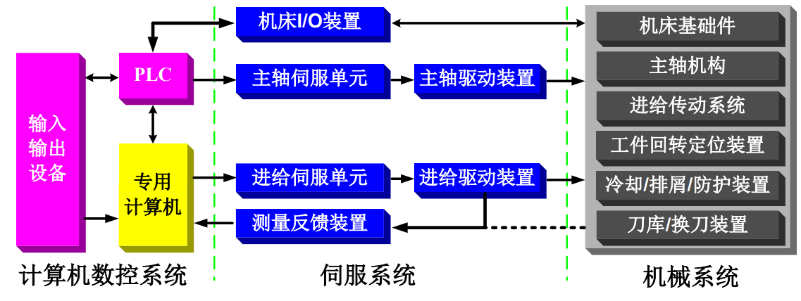
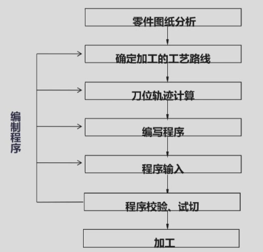
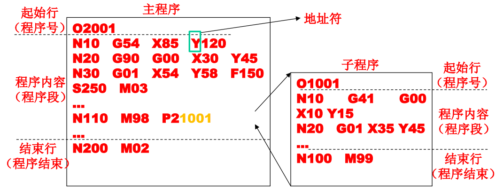
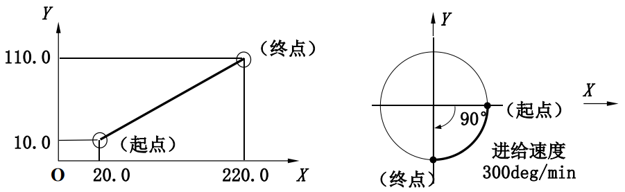
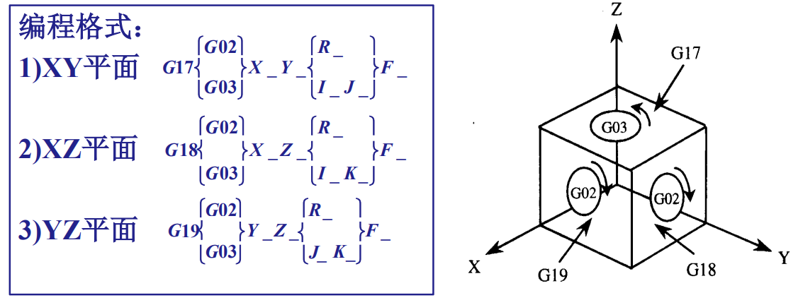
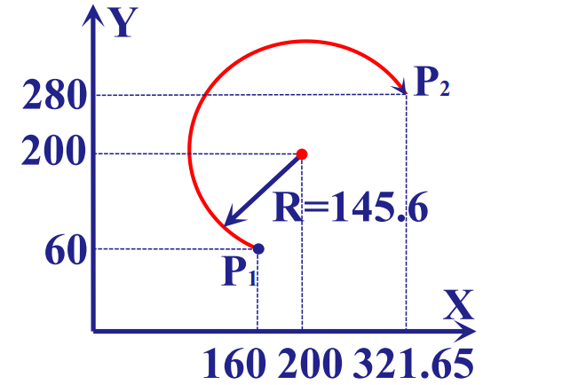
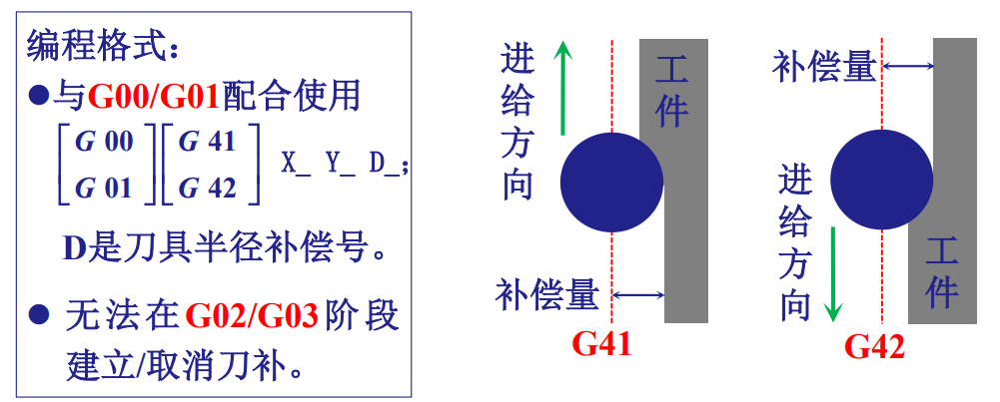
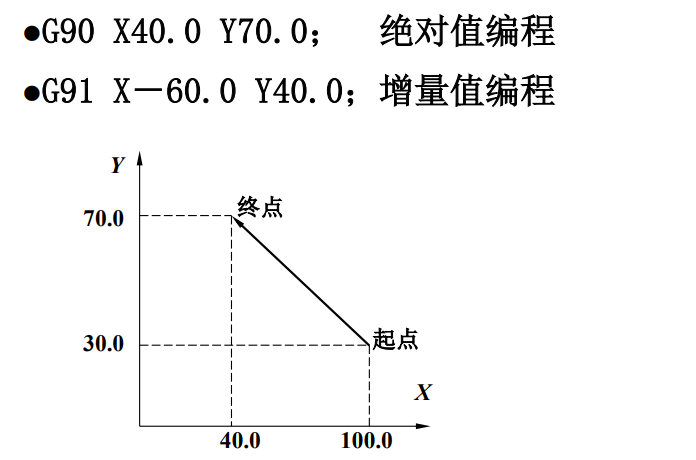
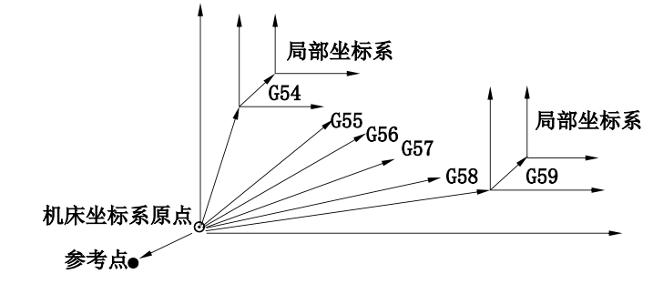
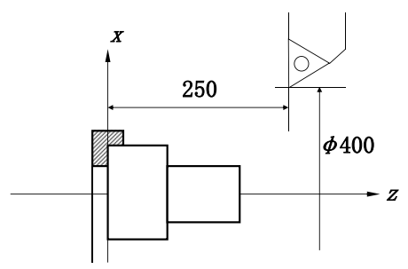

# 数控技术补天提纲
## 第一章  概论
### 基本概念
- 数字控制(NC, Numerical Control)
- 数控机床(NCMT, Numerical Controlled Machine Tool)
- 数控系统(NCS, Numerical Controlled System)
- 计算机数控 (CNC, Computer Numerical Control)
- 计算机辅助设计(CAD, Computer Aided Design)
- 计算机辅助制造(CAM, Computer Aided Manufacturing)
- 计算机辅助工程 (CAE, Computer Aided Engineering)
中文与英文缩写能对应即可
### 数控机床的组成

复习课上写的是数控装置、伺服驱动装置和检测反馈装置、机床本体三部分，对应上面三部分。
### 数控机床的特点
1. 小批量而又轮番生产的零件；
2. 几何形状复杂的零件：
3. 在加工过程中必须进行多种工序加工的零件；
4. 切削余量大的零件；
5. 必须严格控制公差（公差带范围很小）的零件；
6. 工艺设计会经常变化的零件；
7. 贵重零件：
8. 需全部检测的零件，等等。
### 数控机床的分类
#### 按控制系统分类

| 控制方式 | 说明 |
| --- | --- |
| 点位控制 | 只能控制刀具从一个位置精确地移动到另一个位置，而不管中间的移动轨迹如何。 |
| 直线控制 | 不仅要控制两相关点之间的位置，还要控制刀具沿某一坐标方向移动的速度和轨迹。 |
| 轮廓控制 | 同时对两个或两个以上的坐标轴进行连续控制，需要保证加工过程中每个点的速度和位置。 |
#### 按伺服系统分类

| 伺服系统类型 | 工作方式与特点 |
| --- | --- |
| 开环伺服 | 输出信号给伺服系统驱动机床运动，没有来自传感器的反馈信号。较为经济，但速度、精度低。 |
| 闭环伺服 | 接受插补器指令及工作台端反馈信号进行比较修正，有效消除传动部件引起的误差；系统复杂，成本高。 |
| 半闭环伺服 | 测量元件从工作台移到电机端头或者丝杆端头。可以获得稳定的控制特性，且容易调整。 |

#### 按工艺方法分类

| 类别 | 数控机床举例 |
| --- | --- |
| 金属切削类 | 数控车床、数控铣床、数控磨床、数控镗床、加工中心 |
| 金属成形类 | 数控回转头压力机、数控折弯机、数控组合冲床、数控弯管机 |
| 数控特种加工 | 数控线（电极）切割机床、数控电火花加工机床、数控火焰切割机、数控激光切割机床 |
#### 按功能水平分类
高档/中档/低档数控机床，可能按照精度或轴数划分
#### 按驱动方式分类
步进式/直流伺服/交流伺服/非电驱动
## 第二章 数控编程
### 基本概念
根据被加工零件的图纸及其技术要求，工艺要求等切削加工的必要信息，按数控系统所规定的指令和格式编制数控加工指令序列，分为手动编程、自动编程。

### 数控编程内容与步骤

### 数控机床中的坐标
#### 坐标轴
机床的坐标轴包含互相垂直的**X、Y、Z直线运动轴**和绕其旋转的**A、B、C旋转运动轴**。
直线运动轴相互位置关系由**右手直角笛卡尔坐标系**确定，即右手拇指指向 X 轴正向、食指指向 Y 轴正向，那么与二者垂直的中指就指向 Z 轴正向。因此，确定其中两个轴的正向后，第三个轴的正向也就确定了。
旋转运动轴则用**右手螺旋定则**规定正向：右手拇指指向对应直线轴的正方向，其余四指弯曲的方向就是旋转正方向。
某部件运动的**正方向**，是**增大工件和刀具之间距离的方向**
#### z轴确定

- **传递主要切削力的主轴为 Z 轴（铣、车）**。
 - **若没有主轴，则 Z 轴垂直于工件装夹面（刨）**。
#### 工件坐标系与机床坐标系
数控加工中使用的坐标系有两种：
1. 机床坐标系：是机床固有坐标系，**由厂家设定坐标原点（零点）**，不能直接用于编程。
2. 工件坐标系：编程人员以工件图纸上的合适位置建立的坐标系，**编程尺寸都按工件坐标系来确定**。

为了统一两种坐标系，通过**对刀**来确定**程序原点**在**机床坐标系**中的位置，建立**工件坐标系**。
以车外圆为例，对刀可以这么理解：
1. 让刀尖接触或轻车工件右端面，把这个位置作为 Z 零点。
2. 试车一小段外圆，测量实际直径。例如测得直径 60 mm，就把此时刀尖的 X 坐标设为 60。
##### 工件零点的选取原则
1. 工件零点应选在**零件的尺寸基准**上，这样便于坐标值的计算，并减少错误；
2. 工件零点尽量选在**精度较高的工件表面**，以提高被加工零件的加工精度
3. 对于**对称**零件，工件零点设在**对称中心**上；
4. 对**一般零件**，工件零点设在工件轮廓**某一角**上；
5. **Z轴方向上**零点一般设在**工件表面**。
##### 机床参考点
机床参考点是用于对机床运动进行检测和控制的固定点。其位置是由机床制造厂家在每个进给轴上用限位开关精确调整好的，坐标值已输入数控系统中。因此**参考点对机床原点的坐标是一个已知数**。编程时该点一般作为**程序起点**和**换刀点**。
- 通常在**数控铣床**上机床**原点**和机床**参考点**是**重合**的
- 在**数控车床**上机床参考点是**离机床原点最远的极限点**。
### 数控程序的结构与形式
#### 标准
有ISO（国际标准化协会）和EIA（美国电子工业协会）两种标准，不同厂商、产品有一定自主性。
#### 模态代码和非模态代码
模态代码：同组其它代码出现前一直有效。
非模态代码：只在指令它的程序段中有效。
#### 结构

#### 程序序号
程序的记录是由程序号来辩别的，调用某个程序可通过程序号来调出，编辑程序也要首先调出程序号。程序号由字母“O”接4位数（1～9999）表示（如上图O2001、O1001）
#### 程序段结构
程序段主要是由程序段序号和各种功能指令构成的：  
N__ G__ X（U）__ Z（W）__ F__ M__ S__ T__
例如`N10 G01 X80.0 Z100.0 F0.2 M03 S600 T0101`
其中N10为**程序段号**，可以理解为**代码的行号**，考试时以10为单位递增即可（如上图程序）。其余的部分接下来会详细说明。
#### 坐标表示
**绝对坐标**在程序中表示为**X、Y、Z**，**相对坐标**则为**U、V、W**。X、Y、Z与U、V、W在一个程序段内**可以混用**；**车床**数控系统中，X方向坐标值使用**直径值**。
#### F功能
即上面的F__。代表进给速度。两种计算单位：**每分钟进给(mm\min)，每转进给 (mm\r)**。
#### S功能
即上面的S__。代表主轴功能。指令格式：S xxxx
主轴功能也称**主轴转速**功能，它是定义主轴转速的功能。主轴功能由S及后面的数字组成，**单位为r／min**。
#### T功能
即上面的T__。代表刀具功能。指令格式：T xx （xx表示刀具号）　　
T功能是用来进行选择刀具的功能，它是把指定了刀号的刀具转换到换刀位置，为下次**换刀**做好准备。**xx是为下次换刀使用的刀具**，本次所用刀具应在前面程序段中写出。车削中T xx xx **后两位表示刀补号**，Txx**00为取消刀补**
刀补后面会讲
### G代码
G代码代表准备功能，即定义运动方式。
#### G00
快速点定位指令：使刀具以**点位控制**方式从其所在点以最快速度移动到坐标系的另一点。编程格式：`G00 X_Y_Z_` ( X_Y_Z_为目标点坐标)
#### G01
**直线**插补：控制各轴以指定的进给速率**沿直线方向**从当前位置移动到指令位置，**模态代码**。
格式：`G01 Xx Yy Zz Ff`
令$L=\sqrt{x^2+y^2+z^2}$，那么此时x轴方向的进给速度$F_x=\dfrac{x}{L}f$。
例如直线轴插补：`G91 G01 X200.0 Y100.0 F200.0`
旋转轴插补： `G91 G01 C –90.0 F300.0`
此处**G91**表示**采用增量坐标编程**：指令中的坐标值表示相**对于当前位置的位移量**。C这个不要求掌握。

模态代码的意思就是
```
N060 G01 X32.0 Z0.0 S1000 F0.15；
N070 G01 X36.0 Z-2.；
N080 G01 X36.0 Z-40.0；
N090 G01 X60.0 Z-40.0；
N100 G01 X60.0 Z-65.0；
```
可以写成
```
N060 G01 X32.0 Z0.0 S1000 F0.15；
N070 X36.0 Z-2.；
N080 X36.0 Z-40.0；
N090 X60.0 Z-40.0；
N100 X60.0 Z-65.0；
```
写一次后会持续有效，后续程序段可以省略，直到被 G00、G02、G03 等同组指令替换。
#### G02/G03
顺时针/逆时针**圆弧**插补。
**顺、逆方向判断**：沿垂直于圆弧所在平面，从**正向往负向看**，**刀具相对工件**转动方向是顺时针用G02，反之用G03。

这里G17,G18,G19似乎不要求掌握，掌握如何判断顺逆即可。
上面的编程格式中
- X_Y_Z_：圆弧**终点坐标**；
- I_J_K_：**圆心**编程，是**圆弧起点到圆心的X、Y、Z方向增量**，**矢量指向圆心**；
- R_：**半径**编程。

| 程序指令 | 圆弧轨迹 |
| --- | --- |
| `G02 X321.65 Y280 I40 J140 F200`<br>或<br>`G02 X321.65 Y280 R-145.6 F200` |  |

**圆弧大于180度时**用**R为负值**来表示；**整圆时必须用IJK表示**。
#### G41/G42/G40
刀具半径补偿指令：在计算刀具中心轨迹时，把刀具半径考虑进去，从而使刀具切出的边界与零件轮廓一致。
沿加工前进方向，当**刀具中心轨迹在编程轨迹(零件轮廓)左边**时，称为**左刀补**，用G41指令实现；反之为**右刀补**，用G42实现。
**G41/G42:左/右刀具补偿；G40：刀具补偿取消。**

#### G70/G71
G71：外径粗车循环：适用于圆柱毛坯料粗车外径和圆棒毛坯料粗车内径。
G70：精车循环：当用G71粗车工件后，用G70来指定精车循环，切除粗加工中留下的余量。
代码格式
```
N … G71 U(Δd) R (e) ;
N … G71 P(ns) Q(nf) U(Δu) W(Δw) F(f) S (s) T(t) ;
N ns 理论轮廓开始
N … 此部分中的 F/S/T 只对G70生效
N …
N nf 理论轮廓结束
N … G70 P(ns) Q(nf)
```
其中：
- Δd：切削深度（半径给定 ）
- e： 退刀量
- ns： 精加工程序第一个程序段的顺序号。
- nf： 精加工程序最后一个程序的顺序号。
- Δu：X方向精加工余量。（直径值）
- Δw：Z方向精加工余量。
- F,S,T：包含在ns到nf程序段中的任何F、S、T功能在循环中被忽略，而在G71程序段落中F，S或T功能有效。
#### G90/G91
G90是绝对值编程指令，G91是增量值编程指令

| 程序指令 | 编程示例 |
| --- | --- |
| `G90 X40.0 Y70.0`：绝对值编程<br><br>`G91 X-60.0 Y40.0`：增量值编程 |  |

### M代码
M代码代表辅助功能，即机床的辅助动作。

| 指令 | 功能与说明 |
| --- | --- |
| M02 | 程序**结束**。编在最后一个程序段中，执行完程序内所有指令后，主轴停止、进给停止、切削液关闭。 |
| M03 | 主轴**正转**。按 JB/T 3208—1999，正转是右旋螺纹进入工件的旋向。 |
| M04 | 主轴**反转**。按 JB/T 3208—1999，反转是右旋螺纹离开工件的旋向。 |
| M05 | 主轴停转。 |
| M08 | 冷却液开。 |
| M09 | 冷却液关。 |
| M30 | 程序**结束**。除具有 M02 的功能外，还**返回到程序头，准备下一个工件的加工**。 |

#### G54/G92
G54～G59：选择工件坐标系指令

G92：工件坐标系设定指令

| 程序指令 | 坐标系示例 |
| --- | --- |
| `G92 X400. Z250.`<br><br>指定当前点为该坐标值。 |  |

#### M98/M99
子程序调用。格式为`M98 Pxxxx Lxxx`
其中P后面的四位为子程序号，L后面的三位为重复调用次数，最多调用999次

但是这里给出的图格式又为`M98 Pxyyyy`，这里的x是重复调用次数，yyyy是子程序号。总之具体格式取决于数控系统。
M99表示子程序结束，并返回调用它的主程序，继续执行 M98 后面的指令。
### 用户宏程序
实际上宏程序是一种功能。课件上的表述似乎认为其是一种特殊的子程序，但是其实主程序也可以是宏程序。在宏程序主体中，除了使用通常的CNC指令外，还可以**使用变量**的CNC指令，进行变量运算，宏指令可以给变量设定实际值。
意思就是，一般的数控指令只能使用常量，但是宏程序可以使用变量，类似高级编程语言中的变量赋值与运算。
变量用＃和后面的数字表示，其格式为：`＃i`（i =1,2,3…）
变量可以代替宏程序中地址后面的数值。 例：`F＃103`，`G00 Z-＃100`， `G＃130`.
变量代表的真值不能带小数点，因此**尺寸、角度单位用0.001mm（°）** 为单位。例如#100=10，则 X #100 表示 X 0.01 (0.01mm)。
