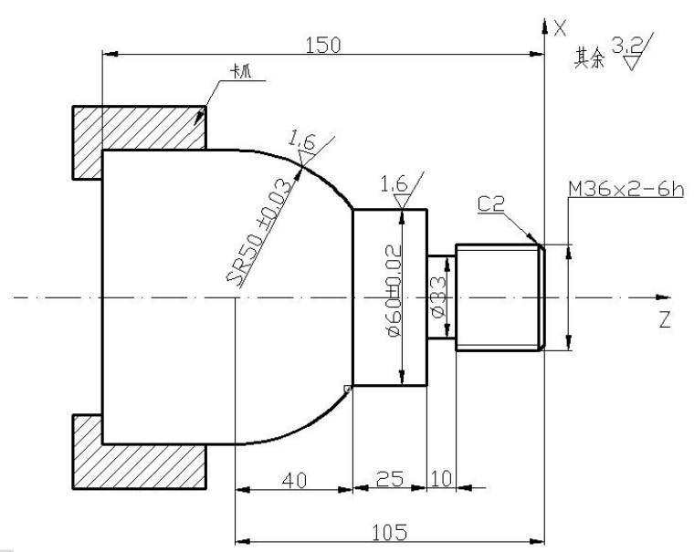
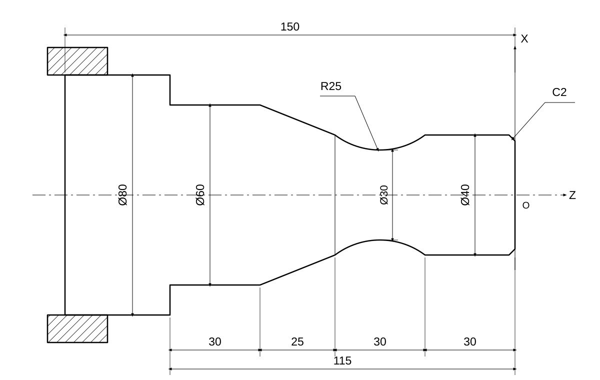
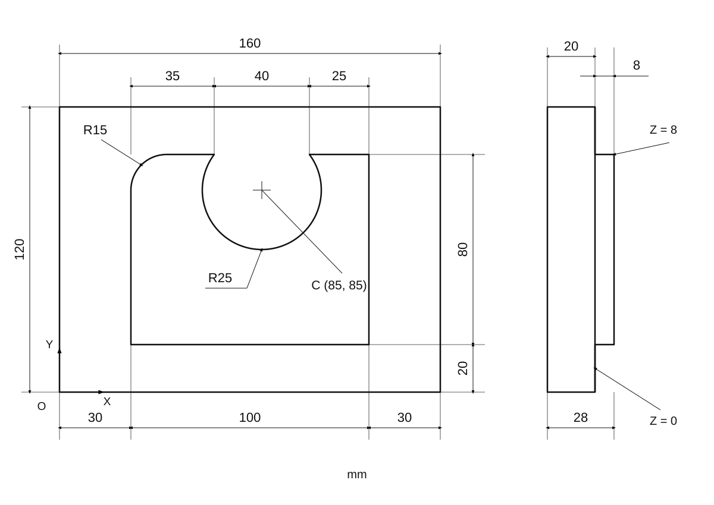

```
O0001
N010 G92 X100.0 Z100.0 T0101;
N020 M03 S350;
N030 G00 X100.0 Z3.0;
N040 M08;

N050 G71 U0.5 R0.1;
N050 G71 P060 Q120 U0.3 W0.3 F0.3;
N060 G01 X32.0 Z0.0 S1000 F0.15;
N070 X36.0 Z-2.0;
N080 Z-40.0;
N090 X60.0;
N100 Z-65.0;
N110 G03 X100.0 Z-105.0 R50.0;
N120 G01 X110.0;
N130 G70 P060 Q120;

N140 M09;
N150 G00 X100.0 Z100.0;
M160 M05;
M170 M30;
```


```
O0001
N010 G92 X100.0 Z100.0 T0101;
N020 M03 S350;
N030 G00 X80.0 Z3.0;
N040 M08;

N050 G71 U5.0 R1.0;
N060 G71 P070 Q140 U0.3 W0.3 F0.3;
N070 G01 X36.0 Z0.0 S1000 F0.15;
N080 X40.0 Z-2.0;
N090 Z-30.0;
N100 G02 X40.0 Z-60.0 R25.0;
N110 G01 X60.0 Z-85.0;
N120 Z-115.0;
N130 X80.0;
N140 X100.0;//退刀
N150 G70 P070 Q140;

N160 M09;
N170 G00 X100.0 Z100.0;
N180 M05;
N190 M30;
```

.svg>)
此处以O为原点，最高处z=+4

```
O0001;
N010 G90 G54 G17; 绝对坐标编程；选择坐标系；选择xy平面
N020 G00 G43 H01 X-50.0 Y-50.0 Z5；刀具长度正向补偿量；移动到安全位置
N030 M03 S350;
N040 G01 Z-4 F100;
N050 G41 X-30 Y-35 D01;

N060 G01 Y15;
N070 G02 X-20 Y25 R10;
N080 G01 X20;
N090 G02 X30 Y15 R10;
N100 G01 Y-15;
N110 G02 X20 Y-25 R10;
N120 G01 X-20;
N130 G02 X-30 Y-15 R10;
N140 G03 X-40. Y-5. R10.;       (圆弧退出凸台外轮廓)
N150 G40 G01 X-50. Y-50.;       (取消半径补偿，移至零件外侧)
N155 G00 Z5.;             (抬至安全高度)

N160 G00 X0. Y-50.;             (在零件下方移到槽口正下方)
N165 G01 Z-4.;       (在零件外侧降至切槽深度)
N170 G01 G41 X8. Y-35. D01; (重新建立左刀补，准备进入槽口)
N180 G01 Y-8.;            (沿槽右侧边界进入)
N190 X15.;                      (加工右侧槽的下边界)
N200 G03 Y8. R8.;               (加工右端半圆槽)
N210 G01 X8.;                   (沿右侧槽的上边界返回)
N220 Y35;
N230 X-8； 
N240 Y8； 
N250 X-15； 
N260 G03 Y-8 R8； 
N270 G1 X-8；Y-35； 
N280 G40 X0 Y-50；

N290 G00 Z5； 
N300 G49 Z100； 取消刀具补偿
N310 M02；
```

铣削，45 号钢，在粗加工的基础上精加工，每层切深 2 mm


```
O0001
N010 G90 G54 G17;
N020 G00 G43 H01 X0 Y0 Z10;
N030 M03 S350;
N040 G01 Z0 F100;
N050 G41 X30 Y10 D01;

N060 G01 Y85;
N070 G02 X45 Y100 R15;
N080 G01 X65 Y100;
N090 G03 X105. Y100. R-25.;
N100 G01 X130.;
N090 Y20;
N100 X20;
N110 G40 X0 Y0;

N290 G01 Z10； 
N300 G49 Z100； 取消刀具补偿
N310 M02；
```