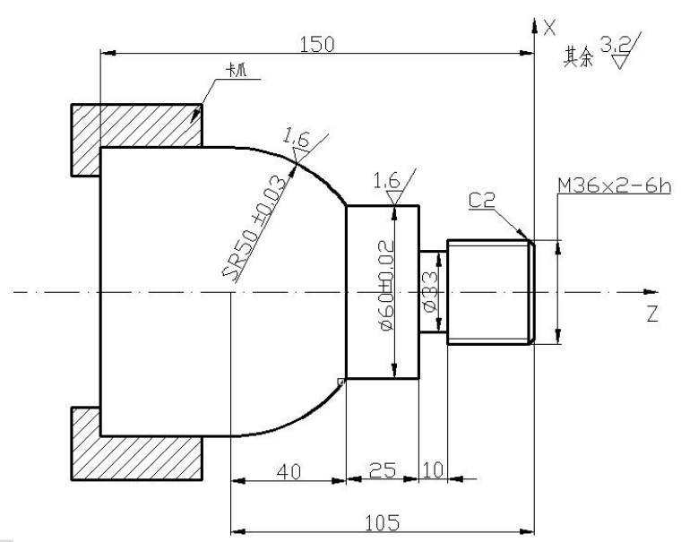
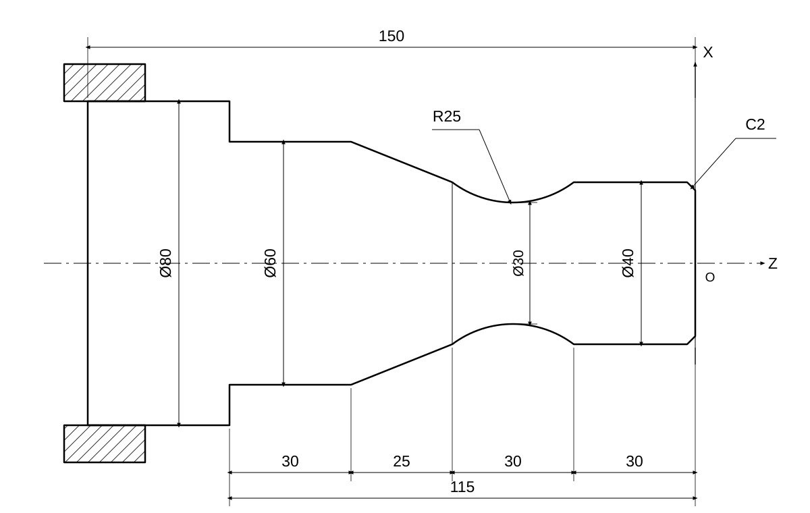

### 作业题2
编写加工程序，加工下图所示零件，毛坯为φ100mmX150mm，材质45钢调质。

我们这里不考虑这个螺纹，复习课没讲。这种题目通用的模板：
粗车→精车→切槽，同时加工过程加冷却液。

| 序号 | 程序段 | 注释 |
|---|---|---|
| **—** | **O0001;** | **程序号** |
| **N010** | **G92 X100.0 Z100.0 T0101;** | **建立工件坐标系，选1号外径刀，1号刀补** 这里的X100.0，Z100.0只是一个安全位置，离工件比较远即可|
| **N020** | **M03 S350;** | **主轴正转，转速350 r/min** |
| **N030** | **G00 X100.0 Z3.0;** | **快速到达粗车循环起点** |
| **N035** | **M08;** | **开冷却液** |
| **N040** | **G71 U5.0 R1.0;** | **粗车循环：每刀切深5 mm（半径值），退刀量1 mm** 考试时直接按这个值取即可。|
| **N050** | **G71 P060 Q120 U0.3 W0.3 F0.3;** | **轮廓范围N060～N120；X向留直径余量0.3 mm，Z向留余量0.3 mm；进给量0.3 mm/r** |
| N060 | G01 X32.0 Z0.0 S1000 F0.15; | 轮廓开始，到达倒角起点；指定精车转速1000 r/min、进给量0.15 mm/r |
| N070 | X36.0 Z-2.0; | 直线插补加工右端C2倒角 |
| N080 | Z-40.0; | 沿Z负方向加工φ36外圆至Z=-40 mm |
| N090 | X60.0; | 沿X正方向加工台阶端面至φ60 |
| N100 | Z-65.0; | 沿Z负方向加工φ60外圆至Z=-65 mm |
| N110 | G03 X100.0 Z-105.0 R50.0; | 逆时针圆弧插补，加工R50圆弧至X100、Z-105 |
| N120 | G01 X110.0; | 沿X正方向直线退出至X110，轮廓结束 |
| **N130** | **G70 P060 Q120;** | **按N060～N120所定义的轮廓进行精车** |
| **N140** | **M09;** | **关闭冷却液** |
| **N145** | **G00 X100.0 Z100.0;** | **快速返回程序起始位置** |
| **N150** | **M05;** | **主轴停止** |
| **N160** | **M30;** | **程序结束并复位** |


| 序号 | 程序段 | 注释 |
|---|---|---|
| — | O0002; | 切槽程序 |
| N010 | G92 X200.0 Z100.0 T0202; | 建立工件坐标系，选2号车槽刀，2号刀补 |
| N020 | M03 S600; | 主轴正转，转速600 r/min |
| N030 | G00 Z-40.0; | 快速移动至Z=-40 mm |
| N040 | X65.0; | 快速移动至X65，达到车槽起点 |
| N045 | M08; | 开冷却液 |
| N050 | G01 X33.0 F0.1; | 径向进给切槽至槽底直径33 mm，进给量0.1 mm/r |
| N060 | X38.0; | 沿X正方向退刀至X38 |
| N070 | G00 Z-36.0; | 沿Z正方向移动4 mm；槽宽10 mm、刀宽6 mm，移动量为10-6=4 mm |
| N080 | G01 X33.0; | 再次径向切槽至X33，完成槽宽加工 |
| N085 | X38.0; | 沿X正方向退刀至X38 |
| N090 | M09; | 关闭冷却液 |
| N100 | G00 X200.0; | 先沿X正方向快速退至X200 |
| N110 | Z100.0; | 再沿Z正方向快速返回Z100 |
| N120 | M05; | 主轴停止 |
| N130 | M30; | 程序结束并复位 |
### 历年题1
车削，45 号钢，先粗加工再精加工，需要写注释


```
O0001
N010 G92 X100.0 Z100.0 T0101;
N020 M03 S350;
N030 G00 X80.0 Z3.0;
N040 M08;

N050 G71 U5.0 R1.0;
N060 G71 P070 Q140 U0.3 W0.3 F0.3;
N070 G01 X36.0 Z0.0 S1000 F0.15;
N080 X40.0 Z-2.0;
N090 Z-30.0;
N100 G02 X40.0 Z-60.0 R25.0;
N110 G01 X60.0 Z-85.0;
N120 Z-115.0;
N130 X80.0;
N140 X100.0;
N150 G70 P070 Q140;

N160 M09;
N170 G00 X100.0 Z100.0;
N180 M05;
N190 M30;
```