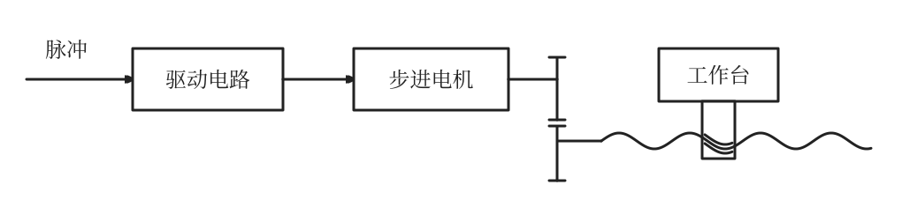
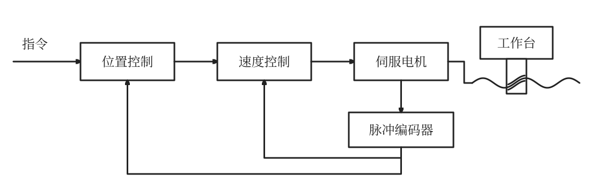
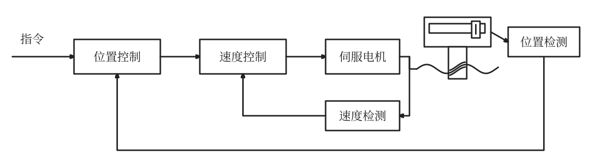

1. 将传统车床改造成数控车床,主轴、进给、控制系统的设计原则

| 改造部分 | 改造内容及设计原则 |
|---|---|
| **主轴系统** | 配置可由数控系统控制的调速驱动；按加工需要选择功率和调速范围，保证变速迅速可靠、主轴刚度好；根据条件选用齿轮、带传动或直接驱动 |
| **进给系统** | 将X、Z轴改为电机独立驱动，配置滚珠丝杠等传动机构；要求传动精度高、响应快、运行稳定、刚度高，摩擦及惯量小，并减小或消除传动间隙 |
| **控制系统** | 配置能够控制X/Z轴运动的CNC系统；用PLC控制主轴正反转、冷却液等辅助动作；按精度、速度、成本要求选择开环、半闭环或闭环方案 |

2. 说出开环、闭环、半闭环系统的特点并画出框图

| 类型 | 特点 | 适用条件 |
| --- | --- | --- |
| **开环伺服系统** | 无位置测量装置和位置反馈，信号单向传递，系统稳定性好；一般采用功率步进电机；结构简单、调试维修方便、价格低，但精度主要取决于驱动系统和机械传动机构。 | 精度和速度要求不高、驱动力矩不大的场合，如经济型数控机床。 |
| **闭环伺服系统** | 理论上可消除整个驱动和传动环节的误差、间隙及失动量，位置控制精度高；机械传动环节的非线性易造成系统不稳定，设计、安装和调试较困难。 | 精度要求很高的镗铣床、超精车床、超精磨床及较大型数控机床。 |
| **半闭环伺服系统** | 环路内不包括或只包括少量机械传动环节，稳定性介于开环和闭环之间；丝杠螺距误差和齿轮间隙引起的误差难以消除，可通过补偿提高精度；结构简单、调试方便，精度较高。 | 适合对精度有较高要求、同时需要调试方便的场合，广泛用于现代 CNC 机床。 |

