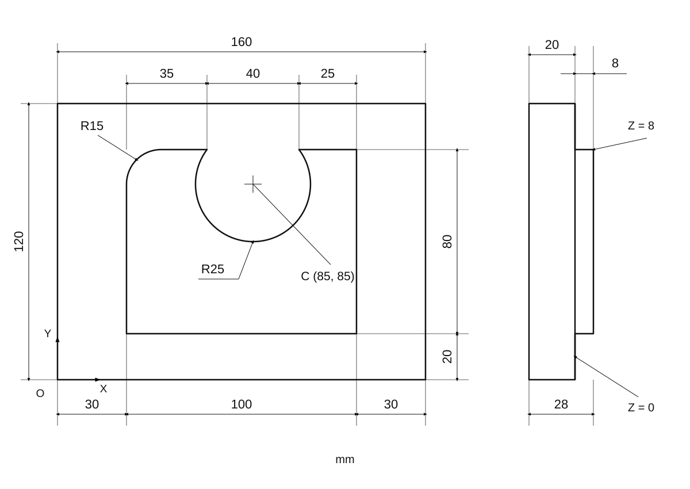
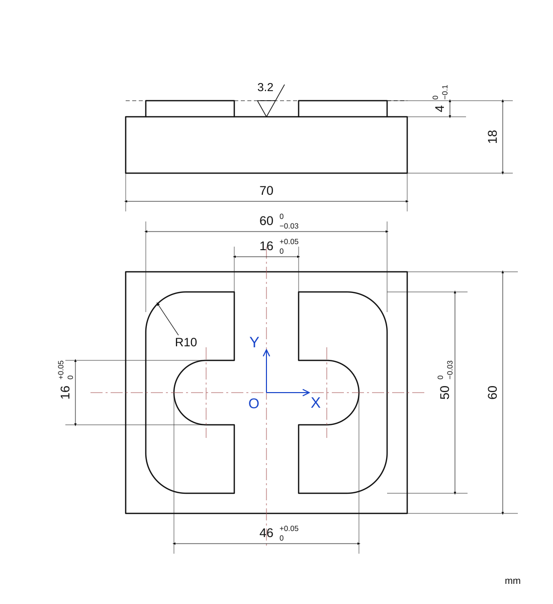
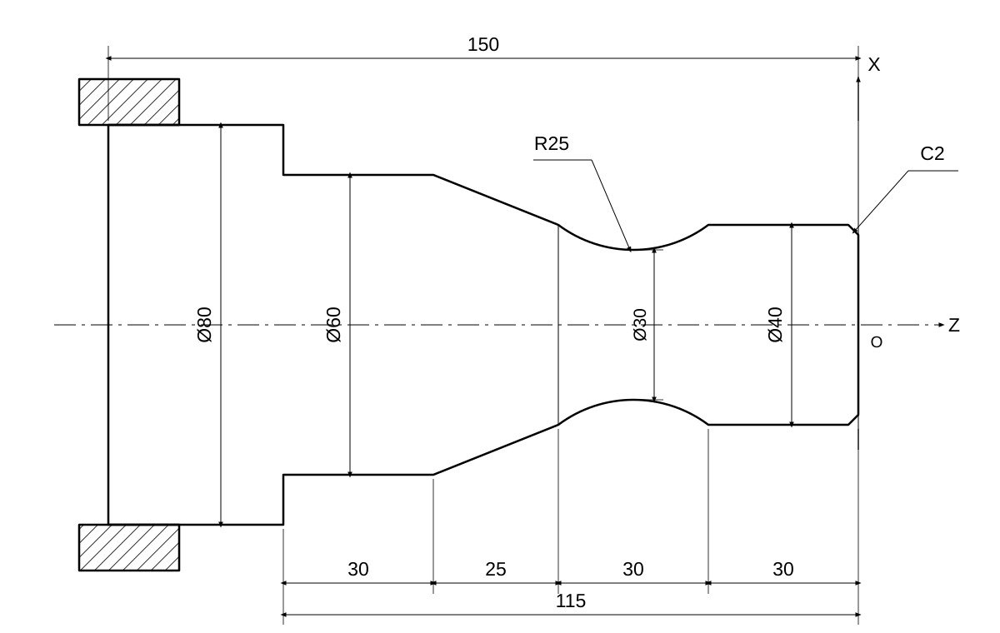

## 铣削
开头模板
```C
O0001
G90 G54 G17;   //绝对量编程，选择坐标系，xy平面
G00 G43 H01 Z安全高度;  //在移动过程中建立刀长补偿
X任意远位置 Y任意远位置; //X,Y也移到远处
M03 S350;  //铣刀开始旋转
G01 Z待加工面高度 F100;  //z轴方向到达待加工面
G41 D01 X离待加工部分较近位置 Y离加工部分较近位置;//在到达离加工部分较近位置时建立刀具半径补偿
```
上面G41前面其实还有G01，只是**模态代码省略**了。同时，由于G41是左刀补，所以**加工时刀具要在工件左边**
接下来中间段可以直接开始加工了。中间段的结尾有一些讲究：
1. 如果你的加工过程一气呵成（如例题1），那么只需要在中间段加工的最后加上

```
G01 G40 X离已加工部分较近位置 Y离已加工部分较近位置;
```
**让刀具在退出的过程中取消半径补偿**即可。
2. 如果你的加工过程分很多段（如例题2），那么每一段加工完成后最好抬起刀具并取消刀补，且第二段开始部分要重新建立刀补。
```C
... //第一段结束
G01 G40 X离开工件 Y离开工件; //取消半径补偿，移至零件外侧
G00 Z安全高度;  //抬到安全高度

G00 X离第二处加工稍远处 Y离第二处加工稍远处; //第二段开头，来到第二处待加工位置附近
G01 Z待加工面高度;
G41 D01 X离第二处加工较近位置 Y离第二处加工较近位置; //重新建立左刀补
```

结尾模板
```C
G01 Z安全高度;
G49 Z100; //退刀
```
这里不直接`G01 G49 Z100`的原因是取消长度补偿后，`Z安全高度` 对应的刀具实际位置可能改变，具体还与数控系统的处理方式有关，不能保证仍是原来的安全高度。
### 例题1（往年真题）

铣削，45 号钢，在粗加工的基础上精加工。

首先，由于这是一个不对称的工件，我们将原点定义在工件左下角，如图所示。
完整代码如下
```C
O0001
//开头段
N010 G90 G54 G17;             //绝对量编程，选择坐标系，xy平面
N020 G00 G43 H01 Z100;        //建立刀长补偿
N025 X-100 Y-100;             //X,Y也移动到距离工件的远点
N030 M03 S350;                //铣刀开始旋转
N040 G01 Z0 F100;             
N050 G41 D01 X30 Y10;         //在抵达待加工点附近的同时建立刀具半径补偿 

//中间段
N060 Y85;                     //加工凸台左边界
N070 G02 X45 Y100 R15;        //加工凸台左上角圆弧，顺时针
N080 G01 X65;                 //加工凸台上边界的左半部分
N090 G03 X105 Y100 R-25;      //加工凸台上边界的圆弧
N100 G01 X130;                //加工凸台上边界的右边部分
N110 Y20;                     //加工凸台右边界
N120 X20;                     //加工凸台下边界，到达工件之外，准备收尾
N130 G40 X0 Y0;               //结尾句，远离工件，取消刀补

//结尾段
N140 G01 Z10;                 //到达安全高度
N150 G49 Z100;                //退刀，取消补偿
N160 M05;                     //铣刀停止旋转
N170 M02;                     //程序结束
```
### 例题2

铣削，45 号钢，在粗加工的基础上精加工。

此题为对称图形，原点设在几何中心。
```
O0001
N010 G90 G54 G17;       //绝对量编程，选择坐标系，xy平面
N020 G00 G43 H01 Z100;  //建立刀长补偿
N030 X-100 Y-100;
N035 M03 S350;
N040 G01 Z0 F100;
N050 G41 D01 X-30 Y-40;

N060 G01 Y15;
N070 G02 X-20 Y25 R10;
N080 G01 X20;
N090 G02 X30 Y15 R10;
N100 G01 Y-15;
N110 G02 X20 Y-25 R10;
N120 G01 X-20;
N130 G02 X-30 Y-15 R10;
N140 G01 X-40;
N150 G40 X-40 Y-40;
N160 G01 Z10;

N170 G00 X0 Y-35;
N180 G01 Z0;
N190 G41 D01 X8 Y-30; 
N200 G01 Y-8;
N210 X15;
N220 G03 X15 Y8 R8;
N230 G01 X8;
N240 Y30;
N250 X-8;
N260 Y8;
N270 X-15;
N280 G03 X-15 Y-8 R8;
N290 G01 X-8;
N300 Y-35;
N310 G40 D01 X0 Y-40;

N320 G01 Z10;
N330 G49 Z100;
N340 M05;
N350 M02;
```
## 车削
开头模板：
```C
G92 X100 Z100 T0101;  //建立坐标系
M03 S350;             //转轴正转
G00 Xx Z待加工点位附近;//这里的x要比毛坯的直径大
M08;//喷冷却液
```
中间段需要注意车削中x是代表直径的
中间段模板
```C
G71 U5 R1; //切深5mm，退刀1mm
G71 P循环开始段 Q循环结束段 U0.3 W0.3 F0.3;//粗加工循环，U,W代表X,Z方向的精加工余量
G01 X? Z? S1000 F0.15
...//循环代码
G70 P循环开始段 Q循环结束段
```
结尾段模板
```C
M09 //关冷却液
G00 X100 Z100//退刀
M05// 转轴停转
M02//程序结束
```
### 例题1（历年真题）

```C
O0001
N010 G92 X100 Z100 T0101;   //建立坐标系，选定刀具和插补
N020 M03 S350;              //转轴开动
N030 G00 X100 Z3;            //移动到近点
N040 M08;                   //开冷却液

N050 G71 U5 R1;
N060 G71 P070 Q130 U0.3 W0.3 f0.3;  //粗加工循环
N070 G01 X36 Z0 S1000 F0.15;        //参数仅对精加工生效
N080 X40 Z-2;
N090 Z-30;
N100 G02 X40 Z-60 R25;              //圆弧看上面一段的走向判断顺逆就行
N110 G01 X60 Z-85;
N120 Z-115;
N130 X90;
N140 G70 P070 Q130;

N150 M09;     //关冷却液
N160 G00 X100 Z100;
N170 M05;
N180 M02;
```