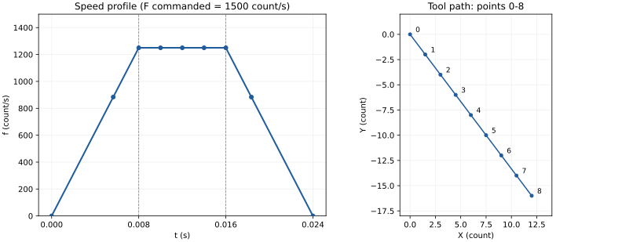
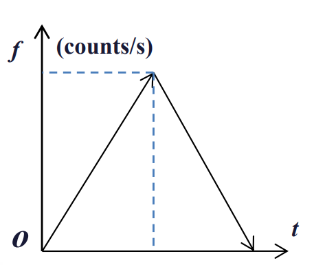

### 定步长插补
#### 加速-匀速-减速情况
假定某数控机床系统，加速度和减速度值相等$A=D=156250count/s^2$,最小插补时间$Tmin=0.002s$。位置和进给率的单位分别count（计数单位）和count/s。 介绍下面线性插补程序段的工作原理。 
`N010 G91 G01 X12 Y-16 F1500`起点为（0,0） 
计算插补参数，并用图形和表格表示最终的刀具路径（注意位置单位用 count，进给率单位用count/s）

总路程
$$L=\sqrt{16^2+12^2}=20\  \text{count}$$
初定步长
\[
\Delta u_0=FT_{\min}
=1500\times0.002=3\ \text{count}
\]
初算插补次数：
\[
N_0=\frac{L}{\Delta u_0}
=\frac{20}{3}\approx6.67
\]
**插补次数圆整为下一个比它大的偶数**$N=8$
圆整为8步后，总路程还是20 count，因此步长：
\[
\boxed{\Delta u=\frac{L}{N}=\frac{20}{8}=2.5\ \text{count}}
\]
题目要求每步不能少于0.002 s，所以最快只能是：
$$F'=\frac{\Delta u}{T_{min}}=1250\ \text{count/s}$$
加速阶段时间
$$t_a=\frac{F'}{A}=0.008s$$
加速阶段距离
$$L_a = \frac{1}{2}At_a^2=5\ \text{count}$$
加速阶段步数$n_a=\dfrac{L_a}{\Delta u}=2$
因为 \(A=D\)，减速距离、时间、步数与加速相同。
匀速阶段距离
$$L_c = L-L_a-L_d=10\ \text{count}$$
匀速阶段时间
$$t_c = \frac{L_c}{F'}=0.008s$$
显然匀速阶段步数为4.
每步轴向增量
$$\begin{cases}
    \Delta x=\dfrac{12}{8}=1.5\ \text{count}\\
    \Delta y=\dfrac{-16}{8}=-2 \ \text{count}
\end{cases}$$

然后按匀加速直线运动的规律算出各等步长插补点的速度、插补间隔（该步长所用时间）、累计时间即可，x和y不用算，因为都是等差数列
| 时钟脉冲\(k\) |进给率 \(F(k)\)（count/s） | 插补间隔\(T_i(k)\)（s） |时间 \(t_k\)（s） | \(x_k\)（count） | \(y_k\)（count） |
|---:|---:|---:|---:|---:|---:|
| 0 | 0.00 | — | 0.000000 | 0.0 | 0 |
| 1 | 883.88 | 0.005657 | 0.005657 | 1.5 | −2 |
| 2 | 1250.00 | 0.002343 | 0.008000 | 3.0 | −4 |
| 3 | 1250.00 | 0.002000 | 0.010000 | 4.5 | −6 |
| 4 | 1250.00 | 0.002000 | 0.012000 | 6.0 | −8 |
| 5 | 1250.00 | 0.002000 | 0.014000 | 7.5 | −10 |
| 6 | 1250.00 | 0.002000 | 0.016000 | 9.0 | −12 |
| 7 | 883.88 | 0.002343 | 0.018343 | 10.5 | −14 |
| 8 | 0.00 | 0.005657 | 0.024000 | 12.0 | −16 |

#### 加速-减速情况

如果题干改为
假定某数控机床系统，加速度和减速度值相等A=D=20000count/s2,最小插补时间Tmin=0.002s。位置和进给率的单位分别count(计数单位）和count/s。 介绍下面线性插补程序段的工作原理。 
N010 G91 G01 X5 Y-3 F600 起点为（0,0） 
计算插补参数，并用图形和表格表示最终的刀具路径（注意位置单位用 count，进给率单位用count/s）

此时你用上面的方法算，总步数为6，加速阶段步数$n_a=\dfrac{L_a}{\Delta u}=6.1>3$，因此没有匀速阶段。$n_a=n_d=3$。此时最大速度应该是$F'=\sqrt{2a \times L_a}=341.5\ \text{counts/s}$
| 时钟脉冲 k | 进给率 f(k) / (count/s) | 插补间隔 / s | 时间 t / s | x(k) / count | y(k) / count |
|---:|---:|---:|---:|---:|---:|
| 0 | 0 | 0 | 0 | 0 | 0 |
| 1 | 200 | 0.010 | 0.010 | 0.833 | -0.5 |
| 2 | 280 | 0.004 | 0.014 | 1.666 | -1.0 |
| 3 | 340 | 0.003 | 0.017 | 2.499 | -1.5 |
| 4 | 280 | 0.003 | 0.020 | 3.332 | -2.0 |
| 5 | 200 | 0.004 | 0.024 | 4.165 | -2.5 |
| 6 | 0 | 0.010 | 0.034 | 5 | -3.0 |

### 丝杠螺母和步进电机
某数控机床采用步进电机，经一对外啮合齿轮驱动丝杠，使工作台做直线运动。已知：
- 步进电机转子齿数 \(Z_0=80\)，每输入一个脉冲，电机转过一个转子齿距。
- 电机轴上的主动齿轮齿数 \(Z_1=20\)，丝杠轴上的从动齿轮齿数为 \(Z_2\)。
- 丝杠为单线丝杠，螺距为 \(12\text{ mm}\)。
- 每输入一个脉冲，工作台移动 \(0.04\text{ mm}\)。
忽略传动间隙及误差，求从动齿轮的齿数 \(Z_2\)，并写出计算过程。
.svg>)

1．步进电机转动的圈数

电机转子有80个齿，每脉冲转过一个齿距，一次脉冲对应：
\[
n_m=\frac{1}{80}\ \text{转}
\]
对应步距角（题目可能会给步距角，了解什么意思即可）：
\[
\alpha=\frac{360^\circ}{80}=4.5^\circ
\]
2．经过齿轮传动后，丝杠转动的圈数

主动齿轮 \(Z_1=20\)，从动齿轮为 \(Z_2\)。齿轮转数与齿数成反比，所以：
\[
n_s=n_m\frac{Z_1}{Z_2}
=\frac1{80}\frac{20}{Z_2}
\]
这里计算的是转动圈数的大小，不考虑旋转方向的正负。

3．计算工作台位移

单线丝杠的导程等于螺距，为12 mm，即丝杠每转一圈，工作台移动12 mm。

因此，每脉冲对应的工作台位移为：
\[
\delta=n_s\times12
=\frac1{80}\frac{20}{Z_2}\times12
\]
代入 \(\delta=0.04\text{ mm}\)：
\[
0.04=\frac{12\times20}{80Z_2}
\]
解得：
\[
\boxed{Z_2=\frac{12\times20}{80\times0.04}=75\text{ 齿}}
\]